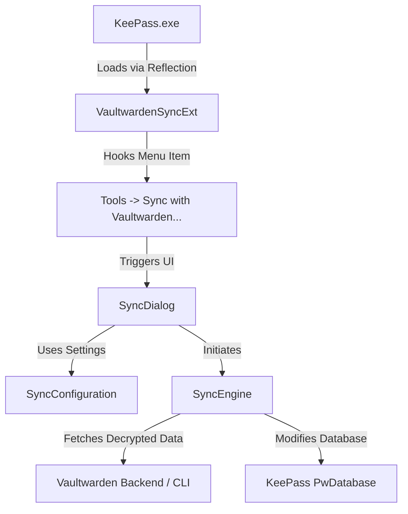

# Design Plan: KeePass Vaultwarden One-Way Sync Plugin

This document outlines the design, architecture, and implementation strategies for a KeePass 2.x plugin that enables one-way synchronization of passwords from a self-hosted **Vaultwarden** (Bitwarden-compatible) vault to a **KeePass** database (`.kdbx`).

---

## 1. Plugin Architecture & KeePass Lifecycle

KeePass 2.x plugins are developed as .NET Framework class libraries (`.dll`) or compiled on-the-fly source packages (`.plgx`). They extend the base `KeePass.Plugins.Plugin` class and interact with the KeePass application via the `IPluginHost` interface.

### Planned Source Files
*   **[VaultwardenSyncExt.cs](file:///C:/Users/MartinKlebermass/OneDrive - retego.ch/dev/bw2keepass/src/VaultwardenSyncExt.cs)**: The main entry point of the plugin, responsible for initialization, hook cleanup, and adding UI elements (e.g., menu items).
*   **[SyncConfiguration.cs](file:///C:/Users/MartinKlebermass/OneDrive - retego.ch/dev/bw2keepass/src/SyncConfiguration.cs)**: Class responsible for storing and retrieving configuration settings (URL, Email, Target Group, Sync Preferences) securely using KeePass's `CustomConfig` and Windows DPAPI.
*   **[SyncEngine.cs](file:///C:/Users/MartinKlebermass/OneDrive - retego.ch/dev/bw2keepass/src/SyncEngine.cs)**: Core logic for retrieving items from Vaultwarden, mapping data structures, merging entries, and updating the KeePass database.
*   **[CryptoService.cs](file:///C:/Users/MartinKlebermass/OneDrive - retego.ch/dev/bw2keepass/src/CryptoService.cs)**: Handles decryption of Vaultwarden ciphers (only required if using the Direct API approach).
*   **[SyncDialog.cs](file:///C:/Users/MartinKlebermass/OneDrive - retego.ch/dev/bw2keepass/src/SyncDialog.cs)**: Windows Forms dialog for credential entry, server settings, and starting the sync process.



---

## 2. Technical Approaches

Since Vaultwarden uses the Bitwarden API, all vault data stored on the server is end-to-end encrypted. We must choose between decrypting the data natively in C# or delegating authentication and decryption to the official Bitwarden Command Line Interface (`bw.exe`).

### Approach A: Direct Vaultwarden API Integration (Native Cryptography)
The plugin communicates directly with the Vaultwarden HTTP API (`/identity/connect/token` and `/api/sync`). It performs cryptographic operations locally inside the plugin.

*   **Authentication**: Performs OAuth2 resource owner password credentials flow to obtain an access token.
*   **Key Derivation**: Computes the master key in C# using PBKDF2-HMAC-SHA256 (or Argon2id) based on the user's account configuration.
*   **Decryption**: Downloads the encrypted sync response, decrypts the user's symmetric key using the derived master key, and decrypts individual folders and login ciphers (AES-256-CBC with HMAC or AES-256-GCM).
*   **Pros**:
    *   **Self-contained**: Zero external dependencies or executable wrappers. No installation of external tools required.
    *   **Seamless UX**: Faster operation and no background processes to manage.
*   **Cons**:
    *   **High Complexity**: Reimplementing Bitwarden's cryptographic structure in C# is complex and prone to security bugs.
    *   **KDF Compatibility**: Support for newer key derivation functions (like Argon2id) requires embedding native libraries or large third-party NuGet dependencies (e.g., `Konscious.Security.Cryptography.Argon2`) which can be bloated or difficult to load dynamically inside KeePass.
    *   **Two-Factor Authentication (2FA)**: Implementing full support for various 2FA methods (TOTP, Duo, FIDO2) directly in a C# dialog is tedious and difficult.

### Approach B: Bitwarden CLI Wrapper (`bw.exe` Integration)
The plugin interfaces with the official Bitwarden CLI executable in the background.

*   **Workflow**:
    1.  The plugin launches `bw.exe` with standard input streams to handle login and unlocking securely.
    2.  It invokes `bw login` and `bw unlock` using the user's credentials to acquire a `BW_SESSION` key.
    3.  It runs `bw list items --session <session>` which outputs a decrypted JSON array of folders and credentials.
    4.  The plugin parses this JSON and merges it into the KeePass database.
    5.  It logs out and wipes session variables.
*   **Pros**:
    *   **Robust & Secure**: Leverages Bitwarden's officially audited cryptographic and authentication engines.
    *   **Feature-Rich**: Automatically supports Argon2, all 2FA types, API keys, and complex nested organization/collection shares without plugin modifications.
    *   **Simpler Codebase**: Decouples cryptography from sync logic.
*   **Cons**:
    *   **External Dependency**: The user must have `bw.exe` on their system, or the plugin must bundle it/download it during installation.
    *   **Inter-process Communication**: Requires careful management of process parameters, pipes, and environment variables to ensure no credentials or session keys leak via command line arguments.

---

## 3. Comparison Matrix

| Metric | Approach A: Direct API (Native C#) | Approach B: CLI Wrapper (`bw.exe`) |
| :--- | :--- | :--- |
| **User Experience** | Seamless, fast, no external software. | Good, but requires configuring or supplying `bw.exe`. |
| **Cryptography Security** | Custom-implemented. Risk of security flaws. | Official Bitwarden engine. High trust. |
| **MFA / 2FA Support** | Hard to implement and maintain. | Fully supported out-of-the-box by CLI. |
| **Argon2 KDF Support** | Requires third-party library references. | Built into the CLI. |
| **Maintenance Cost** | High (must manually update for API changes). | Low (only dependent on stable CLI JSON output). |
| **Binary Size** | Medium (if bundling crypto assemblies). | Large (if bundling `bw.exe` directly). |

---

## 4. One-Way Synchronization Logic

To ensure the sync is stable and non-destructive:
1.  **Identity Matching**: Since KeePass GUIDs are 16-byte values and Vaultwarden IDs are string-based UUIDs, we will store the Vaultwarden ID in a custom entry string field (e.g. `VW_ID`) on the KeePass entry.
2.  **Target Group**: Synced items will be imported into a dedicated group in KeePass (e.g. `Vaultwarden Sync`).
3.  **Folder Mapping**: Vaultwarden folders will map directly to sub-groups under the target KeePass group.
4.  **Creation / Updates**:
    *   If a Vaultwarden item's `VW_ID` does not exist in KeePass: Create a new entry.
    *   If `VW_ID` exists: Compare modification dates. If the Vaultwarden entry is newer, update fields (Title, Username, Password, URL, Notes, Custom Fields, TOTP) in the KeePass entry.
5.  **Deletions Handling**: If an entry exists in KeePass with a `VW_ID` but is missing from the Vaultwarden sync data, we must decide how to handle it (e.g., delete, keep, or move to Recycle Bin).

---

## 5. Security & Credential Storage

*   **No Password Storing**: The plugin will not persist the Vaultwarden Master Password. It will prompt the user during each manual sync trigger.
*   **Persistent Configuration**: Settings like Server URL, Username (Email), Target KeePass Group, and Client ID/Secret (if using API keys) will be stored in KeePass's local configuration file using the built-in configuration framework.
*   **Sensitive Fields**: If client secrets or temporary session keys are saved, they will be encrypted using Windows Data Protection API (DPAPI) via `System.Security.Cryptography.ProtectedData`.

---

## 6. Project Directory Layout

```text
bw2keepass/
├── plugin_design.md                   # This design specification
├── LICENSE                            # Open-source license (e.g., MIT)
├── README.md                          # Project documentation
├── VaultwardenSync.sln                # Visual Studio Solution
├── src/                               # Plugin source code
│   ├── Properties/
│   │   └── AssemblyInfo.cs            # Assembly metadata
│   ├── VaultwardenSyncExt.cs          # Main KeePass plugin extension
│   ├── SyncEngine.cs                  # Logic for mapping and updating entries
│   ├── SyncConfiguration.cs           # Config storage logic
│   ├── SyncDialog.cs                  # Forms Dialog UI for Sync options
│   ├── SyncDialog.Designer.cs
│   ├── SyncDialog.resx
│   └── CryptoService.cs               # Decryption helpers (only for Approach A)
```

---

## 7. Finalized Design Decisions & Security Clarifications

Based on user feedback, the plugin implementation will adhere to the following specifications:

### 1. Integration Approach: Option B (Bitwarden CLI Wrapper)
*   **Security & Data Pipeline Clarification**: The unencrypted vault data is **never** written to a temporary file on disk. 
*   **Mechanism**: The plugin spawns `bw.exe` with standard output redirected. The decrypted JSON output is streamed directly from the CLI process's `stdout` pipe into the plugin's RAM (via a C# string/stream). Once parsed and synced into the KeePass memory database, the memory is cleared.
*   **Session Management**: The plugin will request credentials/session tokens, unlock the vault to obtain a session key, run the sync command, and immediately lock the session (`bw lock`) to minimize exposure.

### 2. Deletions Handling: Move to Recycle Bin (Standard)
*   If an entry with a valid `VW_ID` is present in KeePass but missing from the Vaultwarden sync payload, the sync engine will move that entry to the KeePass database's Recycle Bin group. This prevents accidental data loss while keeping the main folders synced.

### 3. Conflict Resolution: Always Overwrite (One-Way Sync Source of Truth)
*   Vaultwarden is the master database. If a synced entry has been edited locally inside KeePass, those modifications will be overwritten with the Vaultwarden data during sync.

### 4. Authentication: Dual Support (Email/Password & API Keys)
*   The UI dialog will support both standard email/password authentication and API Keys (`client_id` + `client_secret`) to accommodate accounts with Multi-Factor Authentication (MFA) enabled.

### 5. Target Environment: KeePass 2.x / .NET Framework 4.8
*   The project will target .NET Framework 4.8 to ensure optimal compatibility with modern KeePass 2.x installations.

